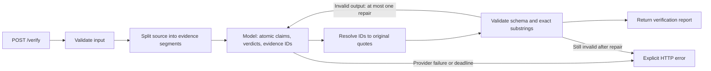

# Design and acceptance criteria

## Objective

Ship a reproducible verifier within one focused day if the acceptance checks pass.
Evaluate progress through an honest baseline, targeted experiments, and a held-out
test set. The [assignment](https://gist.github.com/wsxiaoys/849522ee389e0ce359ef444653084484)
defines the API contract and the three required approaches.

## Decisions before implementation

1. Use Python 3.12 and a small typed HTTP service. Keep model access replaceable.
2. Treat all model outputs and input passages as untrusted data. Validate every
   response before returning success. An exact quote is necessary but is not proof
   of semantic entailment.
3. Preserve numbers, negations, scope, and conditions when extracting claims.
4. Separate provider failures from UNSUPPORTED. Bound input size, time, and retries.
5. Start with a deterministic baseline and a single-call LLM using the same output
   contract. Add complexity only to address observed failures.
6. Build 40 original, explicitly synthetic technical cases: 24 development cases
   and 16 held-out cases. Split by scenario family, not random answer variants.
7. Score end-to-end claim precision/recall and report missed claims, label errors,
   citation validity, evidence sufficiency, latency, token usage, and failures.
8. Record model/configuration, data hash, prompt version, and code revision per run.
   Report unknown costs as unknown, not zero. Include all repair calls.

## Service flow and responsibilities

This diagram describes the compact candidate. `models.py` owns typed contracts
and shared evidence invariants; `verifiers.py` owns strategies and bounded repair;
provider adapters own inference and usage traces; `api.py` maps errors to HTTP;
`scoring.py` and `benchmark.py` evaluate saved outputs independently of inference.

Evidence IDs remove quote transcription from the model's responsibilities. They
do not prove that the selected evidence entails a claim; semantic correctness and
atomic coverage still require evaluation. No retrieval system, database or agent
orchestration is needed for the supplied-context task. The staged alternative is
kept available to test whether its additional calls are justified.

## Acceptance gates

- The HTTP contract and citation invariants hold for every successful response.
- Empty context, non-factual answers, malformed outputs and upstream errors are tested.
- All three implementations run through one benchmark runner.
- Dataset labels, split, and scoring rules are independently reviewable.
- Real model results are kept separate from mocked integration tests.
- A clean checkout can install dependencies, run tests and start the service.
- README contains the results and limitations of the actual submitted version.

## Evaluation integrity

Freeze the final test set before prompt iteration. Run development experiments
first. One-to-one claim matching counts missing claims as false negatives and
duplicates as false positives. Ambiguous alignments need an explicit review file.
Inspecting final-test failures for another improvement makes that set development
material; disclose it and obtain fresh independent validation.

## Public repository scope

Publish code, original examples, decisions, test evidence and experiment summaries.
Keep credentials, recruiting correspondence and unrelated personal files out.
